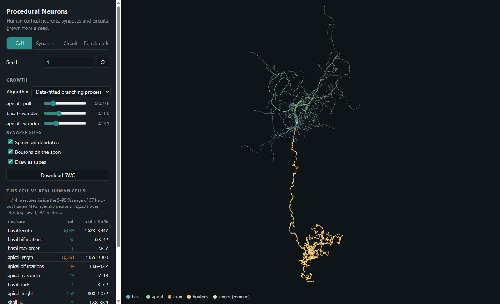

# Procedural Neurons

Grows 3D human brain cells (cortical neurons) in the browser from a random
seed. Three growth algorithms are fitted to 133 real human neurons and tested
on 57 they never saw. The data-fitted one comes closest to the real cells.



**Try it:** https://adam-chung-engineering-portfolio.web.app/neurons-demo/

To run it locally: `python -m http.server 8000 -d web`, then open
http://localhost:8000. It is a static page with no build step.

## What it generates

| View | What you see | Technique |
|---|---|---|
| **Cell** | A full pyramidal neuron: basal and apical dendrites, axon | One of three growth algorithms (below); tubes swept with parallel-transport frames |
| **Benchmark** | The three algorithms side by side, and how realistic each one is | Random-search fitting and held-out scoring |

Every view is deterministic. One seed feeds a tree of hash-keyed random
streams (`Rng.fork(label)`), so moving one slider changes only what that
slider controls.

## Three ways to grow a neuron

| Algorithm | Idea | Code |
|---|---|---|
| **Stochastic L-system** | A grammar is rewritten in parallel, then drawn by a 3-D turtle. Side branches split in two; the apical dendrite and axon grow as a main stem with lateral branches. Tropism pulls the stem toward the pia or white matter. | `web/src/grow/lsystem.js` |
| **Space colonization** | Attractor points fill an envelope (a basal sphere, an apical shaft plus tuft, an axon ellipsoid). Each round, every attractor pulls on its nearest branch tip if it lies ahead of the tip; tips step toward their attractors, split when the pull comes from two clearly different directions, and stop when nothing is ahead. Reached attractors die. | `web/src/grow/colonization.js` |
| **Data-fitted branching process** | Every decision is sampled from distributions measured on real human cells, by inverse CDF: bifurcation probability per branch order (separately for the main stem), section lengths, angles, trunk counts. | `web/src/grow/fitted.js` |

All three share a post-pass that sets branch radii by Rall's 3/2 pipe rule
(one backward sweep over the tree), capped at a trunk radius each cell draws
from the radii measured on real cells.

### Benchmark: which one looks most like a real neuron?

Real data: 190 human middle temporal gyrus layer 2/3 pyramidal neurons from
NeuroMorpho.Org (Mohan et al. 2015; Allen Institute), split 133 for training
and 57 held out.

Each algorithm got the same budget: random search over its parameters
(200 candidates per neurite type, 16 cells each, with the top 5 re-scored on
64 cells). The objective is matching the training cells' 5th, 50th and 95th
percentiles of lengths, branch points, branch order, trunks and height, plus
branch straightness for algorithms that have a parameter for it. The six
Sholl crossing counts are never fitted to.

Then each algorithm grew 133 new cells, which were compared with the 57
held-out cells by the Kolmogorov–Smirnov distance between the two
distributions of each measure (0 is identical, 1 is no overlap). All 14
measures are computed as NeuroM computes them. **Real** is the training cells
compared with the held-out cells the same way, the best any generator can
expect with this many cells. A measure counts as "like real" when the
difference is not statistically significant (distance below 0.21, p < 0.05).

| | Data-fitted | L-system | Space colonization | Real |
|---|---|---|---|---|
| Distance on measures never fitted to (Sholl) | **0.33** | 0.41 | 0.69 | 0.13 |
| Distance on measures fitted to | **0.13** | 0.33 | 0.49 | 0.11 |
| Measures like real | **8 / 14** | 3 / 14 | 0 / 14 | 14 / 14 |
| Time per cell (Node) | 5 ms | 6 ms | 40 ms | |

What it shows:
- **Data-fitted** matches what it was fitted to almost as well as real cells
  match each other. That is partly by construction: it samples trunk counts,
  section lengths and branching probabilities straight from the training cells.
- **The Sholl profile is the weak point for all three.** Between 50 and
  200 µm from the soma, generated cells cross each sphere about 30 % less
  often than real ones (data-fitted median 20 vs a real 30 at 150 µm), even
  where total length and branch counts match. Their branches wander around
  instead of reaching outward.
- **The L-system** gets there with 25 interpretable parameters, but over-branches
  its apical tree (median 36 bifurcations vs a real 25).
- **Space colonization** is the most art-directable, since you shape the
  envelope, and the least realistic: dendrites split into many short twigs
  near the soma and rarely reach 100 µm out.

The old score, the share of generated cells inside the real 5–95 % range,
rated these 87 %, 82 % and 73 %. It rewards every cell landing near the
middle and cannot see a wrong spread, so it flattered all three.

## How it is built

```
web/                      the engine and the demo; plain ES modules, no build step
  src/grow/               the three growth algorithms behind one interface
  src/spatial/grid.js     uniform-grid spatial hash
  src/mesh.js             three.js geometry (tubes, soma surface)
  tools/fit.mjs           fitting (Node)
  tools/benchmark.mjs     benchmark against held-out cells (Node)
  tools/cli.mjs           grow cells to SWC files (Node)
  data/                   real-cell targets, fitted parameters, benchmark results
scripts/                  Python: download real cells, measure them with NeuroM
neurogen/                 Python: morphometrics of real cells (NeuroM)
docs/background/          the literature review behind the choices
```

**One engine, two hosts.** The generators are plain JavaScript, so the same
code runs live in the browser and in Node for fitting, benchmarking and tests.
Python does what the neuroscience tools are best at: downloading and
measuring real reconstructions with NeuroM. A parity test checks that the JS
morphometrics equal NeuroM's on the same cells, so generated and real cells
are measured with the same ruler.

The pipeline:
1. `fetch_morphologies.py` downloads the real cells.
2. `measure_morphology.py` writes `web/data/real_cells.json`.
3. `fit.mjs` writes `params.json`, then calls `benchmark.mjs`, which writes
   `benchmark.json`.
4. The demo reads all three.

**Performance notes.** Space colonization only looks at attractors within
reach of a growing tip, so a round costs as much as the growing front, not the
whole envelope; looping over every attractor each round was 20–40× slower.
The grid packs cell coordinates into one number as the hash key; string keys
were the bottleneck.

## Run it locally

```bash
python -m http.server 8000 -d web                       # the demo
node --test web/tests/*.test.mjs                        # engine tests, ~5 s
node web/tools/cli.mjs grow --algo lsystem --n 5        # cells as SWC files
```

To rebuild the data (needs Python 3.11+ and network access):

```bash
python -m venv .venv && .venv/Scripts/python -m pip install -e ".[dev]"
.venv/Scripts/python scripts/fetch_morphologies.py      # ~190 human cells from NeuroMorpho.Org
.venv/Scripts/python scripts/measure_morphology.py      # -> web/data/real_cells.json
node web/tools/fit.mjs                                  # -> params.json, benchmark.json (~2.5 h; colonization dominates)
node web/tools/benchmark.mjs                            # re-score params.json only, seconds
.venv/Scripts/python -m pytest                          # JS metrics equal NeuroM's
```

## Sources

The papers give each algorithm its method and say which quantities to
measure. The numbers themselves come from the 133 training cells: measured on
them, or tuned by the fitting search against them.

- **Data-fitted branching process:** L-Neuron's approach (Ascoli & Krichmar
  2000): every decision is drawn from distributions measured on real cells.
  The main stem and side branches get separate branching tables, as
  Samsonovich & Ascoli (2005) found hippocampal CA1 apical dendrites need
  (main and oblique branches sampled apart). Measured: trunk counts and angles, bifurcation
  probability by branch order, internal and terminal section lengths,
  bifurcation angles, soma radius. Tuned (8): wander, persist, pull.
- **Stochastic L-system:** Prusinkiewicz & Lindenmayer (1990). L-Neuron
  (Ascoli & Krichmar 2000) writes neurons the same way. Tuned: all 25
  parameters.
- **Space colonization:** Runions, Lane & Prusinkiewicz (2007). Tuned: all 21
  parameters.
- **All three:** radii by Rall's 3/2 rule (Rall 1959).
- **Real cells:** Mohan et al. (2015) and the Allen Cell Types Database, via
  NeuroMorpho.Org (Ascoli, Donohue & Halavi 2007).
- **Related synthesis methods:** Cuntz et al. 2010 (TREES) and Kanari et al.
  2022 (NeuroTS). The literature review is in
  [`docs/background/`](docs/background/).

### References

- Allen Institute for Brain Science. Allen Cell Types Database.
  [celltypes.brain-map.org](https://celltypes.brain-map.org/)
- Ascoli GA, Donohue DE, Halavi M (2007). NeuroMorpho.Org: a central resource
  for neuronal morphologies. *J Neurosci* 27(35): 9247–9251.
  [doi:10.1523/JNEUROSCI.2055-07.2007](https://doi.org/10.1523/JNEUROSCI.2055-07.2007)
- Ascoli GA, Krichmar JL (2000). L-Neuron: a modeling tool for the efficient
  generation and parsimonious description of dendritic morphology.
  *Neurocomputing* 32–33: 1003–1011.
  [doi:10.1016/S0925-2312(00)00272-1](https://doi.org/10.1016/S0925-2312(00)00272-1)
- Mohan H, et al. (2015). Dendritic and axonal architecture of individual
  pyramidal neurons across layers of adult human neocortex. *Cereb Cortex*
  25(12): 4839–4853. [doi:10.1093/cercor/bhv188](https://doi.org/10.1093/cercor/bhv188)
- Prusinkiewicz P, Lindenmayer A (1990). *The Algorithmic Beauty of Plants*.
  Springer. [doi:10.1007/978-1-4613-8476-2](https://doi.org/10.1007/978-1-4613-8476-2)
- Rall W (1959). Branching dendritic trees and motoneuron membrane
  resistivity. *Exp Neurol* 1: 491–527.
  [doi:10.1016/0014-4886(59)90046-9](https://doi.org/10.1016/0014-4886(59)90046-9)
- Runions A, Lane B, Prusinkiewicz P (2007). Modeling trees with a space
  colonization algorithm. *Eurographics Workshop on Natural Phenomena*, 63–70.
  [doi:10.2312/NPH/NPH07/063-070](https://doi.org/10.2312/NPH/NPH07/063-070)
- Samsonovich AV, Ascoli GA (2005). Statistical determinants of dendritic
  morphology in hippocampal pyramidal neurons: a hidden Markov model.
  *Hippocampus* 15(2): 166–183. [doi:10.1002/hipo.20041](https://doi.org/10.1002/hipo.20041)
